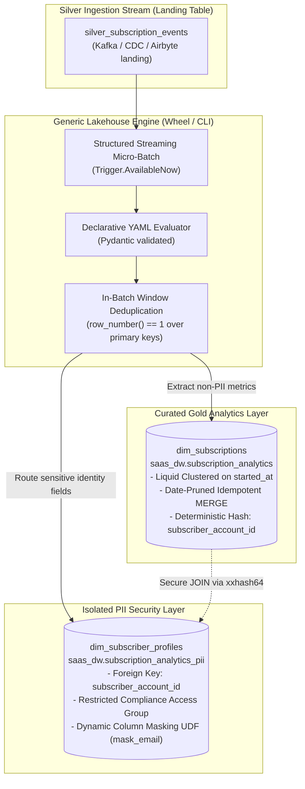
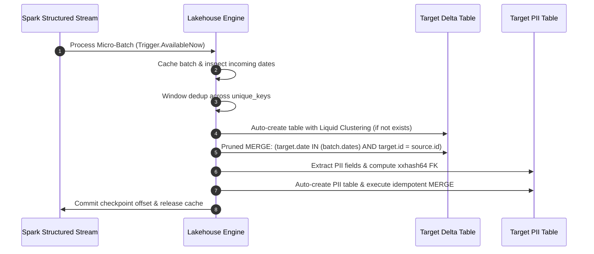

# Databricks Lakehouse Metadata-Driven ETL Boilerplate

[](LICENSE)
[](pyproject.toml)
[](terraform/modules/databricks_job/variables.tf)
[](terraform/main.tf)

A production-ready, metadata-driven framework for building scalable **Medallion Lakehouse Architectures** on Databricks.

Instead of writing bespoke, repetitive pipeline code and compiling monolithic binaries for every new entity, this framework uses **declarative YAML definitions** evaluated by a generic, optimized PySpark streaming engine with **automated PII segregation**, **Databricks Liquid Clustering**, and **Terraform IaC**.

Works identically across **Databricks Enterprise (Unity Catalog)**, **Databricks Community Edition (100% Free Tier)**, and **local laptop PySpark environments**.

---

## 🎯 Architecture Diagram

### 1. Medallion Data Flow & Automated PII Split



### 2. Micro-Batch Execution Lifecycle



---

## 🤖 Context Files for AI Agents (Cursor, Claude, Copilot)

This repository includes full architectural context specifications in the [`context/`](context/) directory to allow LLMs to generate compliant configs and code without hallucinations:
- **[`CLAUDE.md`](CLAUDE.md)**: Agent rules, command cheat-sheet, and code style.
- **[`context/architecture_overview.md`](context/architecture_overview.md)**: Medallion design and declarative metadata concepts.
- **[`context/delta_lake_engine_norms.md`](context/delta_lake_engine_norms.md)**: Liquid clustering rules, in-batch deduplication, and pruned MERGE patterns.
- **[`context/pii_segregation_patterns.md`](context/pii_segregation_patterns.md)**: PII isolation, deterministic hash linkage (`xxhash64`), and dynamic column masking UDFs.
- **[`context/databricks_free_tier_guide.md`](context/databricks_free_tier_guide.md)**: Complete guide for Databricks Community Edition and local environments.

---

## 📁 Repository Structure

```text
├── configs/
│   ├── templates/
│   │   └── entity_template.yml    # Scaffolding template for new entities
│   └── examples/
│       └── subscriptions.yml      # Anonymized SaaS subscription + PII profile example
├── context/                       # In-depth architectural context for LLMs & Engineers
│   ├── architecture_overview.md
│   ├── delta_lake_engine_norms.md
│   ├── pii_segregation_patterns.md
│   └── databricks_free_tier_guide.md
├── src/
│   └── lakehouse_engine/
│       ├── cli.py                 # Databricks workflow entry point CLI
│       ├── models/
│       │   └── config.py          # Pydantic schema validation for configs
│       └── core/
│           ├── delta_ops.py       # Liquid clustering, in-batch dedup, pruned MERGE
│           ├── pii.py             # PII extraction and isolation logic
│           ├── streaming.py       # Micro-batch streaming coordinator
│           └── transformer.py     # SQL expression and attribute evaluator
├── terraform/
│   ├── env_conf/                  # Per-environment variables (dev, prod)
│   ├── modules/
│   │   ├── databricks_job/        # Single-node spot workflow definition
│   │   └── unity_governance/      # Catalog, PII schemas, masking UDFs, ACLs
│   ├── main.tf                    # Root composition
│   └── variables.tf
├── tests/
│   ├── conftest.py                # Local PySpark session fixture
│   └── test_config.py             # Pydantic YAML schema validation tests
├── CLAUDE.md                      # AI agent coding guidelines & rules
├── pyproject.toml                 # Modern PEP 621 Python packaging
├── Taskfile.yml                   # Unified developer automation commands
└── README.md
```

---

## ⚡ Quickstart: Adding a New Entity in 3 Minutes

### Step 1: Create Entity Config
Copy [configs/templates/entity_template.yml](configs/templates/entity_template.yml) to `configs/examples/subscriptions.yml`:

```yaml
version: "1.0"
entity_name: "subscriptions"

source:
  catalog: "raw_landing"
  schema: "event_stream"
  table: "silver_subscription_events"

runtime:
  trigger_type: "AvailableNow"
  max_mbytes_per_trigger: 2000
  checkpoint_location: "dbfs:/checkpoints/lakehouse_engine/subscriptions"

# Non-PII Gold Curated Table
gold:
  catalog: "saas_dw"
  schema: "subscription_analytics"
  table: "dim_subscriptions"
  unique_keys: ["subscription_id"]
  cluster_by: ["started_at"]
  prune_column: "started_at"
  fields:
    - name: "subscription_id"
      type: "string"
      expr: "payload.subscriptionId"
    - name: "plan_tier"
      type: "string"
      expr: "payload.plan.tier"
    - name: "mrr_amount"
      type: "double"
      expr: "cast(payload.plan.amountCents as double) / 100.0"
    - name: "started_at"
      type: "timestamp"
      expr: "cast(payload.startedOn as timestamp)"
    - name: "subscriber_account_id"
      type: "string"
      expr: "xxhash64(cast(payload.subscriberId as string))"

# Automated PII Isolation: Route contact data to restricted _pii schema
pii_splits:
  - name: "subscriber_profiles"
    target_catalog: "saas_dw"
    target_schema: "subscription_analytics_pii"
    target_table: "dim_subscriber_profiles"
    unique_keys: ["subscriber_account_id"]
    foreign_key_expr: "xxhash64(cast(payload.subscriberId as string))"
    foreign_key_name: "subscriber_account_id"
    cluster_by: ["created_at"]
    fields:
      - name: "subscriber_email"
        type: "string"
        expr: "payload.subscriber.email"
        mask_policy: "mask_email"
      - name: "billing_phone"
        type: "string"
        expr: "payload.subscriber.phone"
```

### Step 2: Validate Locally
Run the automated test suite:
```bash
task test
```

### Step 3: Deploy via Terraform
```bash
task tf:plan ENV=dev
task tf:apply ENV=dev
```

---

## 🆓 Using with Databricks Free Tier (Community Edition)

You can run and showcase this entire framework on **Databricks Community Edition (100% Free)**:

1. **Sign up for free** at [community.cloud.databricks.com](https://community.cloud.databricks.com/).
2. **Build the wheel**:
   ```bash
   task build
   ```
3. **Upload the Wheel**: In your free Community cluster, navigate to **Compute** $\rightarrow$ **Libraries** $\rightarrow$ **Install New** $\rightarrow$ **Python Whl** $\rightarrow$ select `dist/lakehouse_engine-0.1.0-py3-none-any.whl`.
4. **Run via Notebook**: Create a Python notebook and execute:
   ```python
   import yaml
   from lakehouse_engine.models.config import EntityPipelineConfig
   from lakehouse_engine.core.streaming import run_pipeline

   # Read the config and run
   with open("/Workspace/Shared/subscriptions.yml") as f:
       config = EntityPipelineConfig.model_validate(yaml.safe_load(f))
   
   run_pipeline(spark, config)
   ```
*(For complete step-by-step notebook scripts and sample data generator, see [context/databricks_free_tier_guide.md](context/databricks_free_tier_guide.md)).*

---

## 🛠️ Developer Commands (`Taskfile.yml`)

| Command | Description |
| :--- | :--- |
| `task install` | Installs local Python environment and dev dependencies |
| `task test` | Runs unit tests with `pytest` |
| `task lint` | Runs `ruff` linter and `mypy` type checking |
| `task format` | Formats code with `ruff` |
| `task build` | Builds the lightweight `.whl` package to `dist/` |
| `task tf:plan ENV=dev` | Runs `terraform plan` against specified environment |
| `task tf:apply ENV=prod` | Deploys Terraform resources to specified environment |

---

## 📄 License
Licensed under the [Apache-2.0 License](LICENSE).
