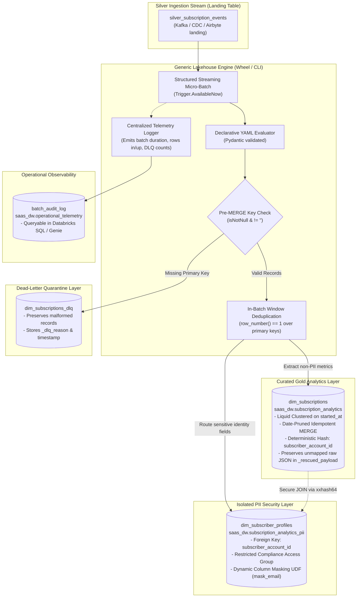

# Databricks Lakehouse Metadata-Driven ETL Boilerplate

[](LICENSE)
[](pyproject.toml)
[](terraform/modules/databricks_job/variables.tf)
[](terraform/main.tf)

A production-ready, metadata-driven framework for building scalable **Medallion Lakehouse Architectures** on Databricks.

Instead of writing bespoke, repetitive pipeline code and compiling monolithic binaries for every new entity, this framework uses **declarative YAML definitions** evaluated by a generic, optimized PySpark streaming engine with **automated PII segregation**, **Databricks Liquid Clustering**, **Dead-Letter Queue (DLQ) quarantine**, **centralized micro-batch telemetry**, and **Databricks Genie AI semantic enrichment**.

Works identically across **Databricks Enterprise (Unity Catalog)**, **Databricks Community Edition (100% Free Tier)**, and **local laptop PySpark environments**.

---

## 🎯 Architecture Diagram

### 1. Medallion Data Flow with DLQ & Automated PII Split



---

## 🛡️ Production Hardening Features

1. **Zero Data Loss via Dead-Letter Queue (DLQ)**:
   - Malformed records with null or empty primary keys are segregated to `<target_table>_dlq` with `_dlq_reason` and `_dlq_timestamp`.
   - The primary Gold table remains clean, while bad records are preserved for audit and recovery.
2. **Raw Payload Preservation (`_rescued_payload`)**:
   - The engine automatically captures the raw unmapped JSON in `_rescued_payload` so newly added upstream fields are never lost during schema drift.
3. **Centralized Operational Telemetry**:
   - Every micro-batch logs exact execution time, rows read, rows inserted, rows updated, and DLQ counts into a queryable Delta audit table (`runtime.audit_table`).
4. **Automated Semantic Catalog for Databricks Genie**:
   - Synchronizes table/column `COMMENT`s and Unity Catalog `PRIMARY KEY / FOREIGN KEY NOT ENFORCED` constraints, providing conversational AI agents with accurate star-schema context.

---

## 📁 Repository Structure

```text
├── configs/
│   ├── templates/
│   │   └── entity_template.yml    # Scaffolding template for new entities
│   └── examples/
│       └── subscriptions.yml      # Anonymized SaaS subscription + PII profile example
├── context/                       # In-depth architectural context for LLMs & Engineers
│   ├── phase1_hardening_guide.md  # DLQ and Operational Telemetry specifications
│   ├── genie_kimball_modeling_guide.md
│   ├── agentic_semantic_catalog.md
│   ├── architecture_overview.md
│   ├── delta_lake_engine_norms.md
│   ├── pii_segregation_patterns.md
│   └── databricks_free_tier_guide.md
├── src/
│   └── lakehouse_engine/
│       ├── cli.py                 # Databricks workflow entry point CLI & export-genie
│       ├── models/
│       │   └── config.py          # Pydantic schema validation for configs
│       └── core/
│           ├── audit.py           # Centralized operational telemetry logger
│           ├── dlq.py             # Pre-MERGE validation & DLQ quarantine
│           ├── genie.py           # Genie instructions & constraint DDL compiler
│           ├── delta_ops.py       # Liquid clustering, in-batch dedup, pruned MERGE
│           ├── pii.py             # PII extraction and isolation logic
│           ├── streaming.py       # Micro-batch streaming coordinator
│           └── transformer.py     # SQL expression and attribute evaluator
├── terraform/
│   ├── env_conf/                  # Per-environment variables (dev, prod)
│   ├── modules/
│   │   ├── databricks_job/        # Single-node spot workflow definition
│   │   └── unity_governance/      # Catalog, PII schemas, masking UDFs, ACLs
│   ├── main.tf                    # Root composition
│   └── variables.tf
├── tests/
│   ├── conftest.py                # Local PySpark session fixture
│   ├── test_config.py             # Pydantic YAML schema validation tests
│   └── test_phase1_dlq_audit.py   # DLQ & Telemetry test assertions
├── CLAUDE.md                      # AI agent coding guidelines & rules
├── pyproject.toml                 # Modern PEP 621 Python packaging
├── Taskfile.yml                   # Unified developer automation commands
└── README.md
```

---

## ⚡ Quickstart: Adding a New Entity in 3 Minutes

### Step 1: Create Entity Config
Copy [configs/templates/entity_template.yml](configs/templates/entity_template.yml) to `configs/examples/subscriptions.yml`:

```yaml
version: "1.0"
entity_name: "subscriptions"

source:
  catalog: "raw_landing"
  schema: "event_stream"
  table: "silver_subscription_events"

runtime:
  trigger_type: "AvailableNow"
  max_mbytes_per_trigger: 2000
  checkpoint_location: "dbfs:/checkpoints/lakehouse_engine/subscriptions"
  audit_table: "saas_dw.operational_telemetry.batch_audit_log"

gold:
  catalog: "saas_dw"
  schema: "subscription_analytics"
  table: "dim_subscriptions"
  table_comment: "Curated SaaS subscription dimension. Non-PII analytics safe."
  unique_keys: ["subscription_id"]
  cluster_by: ["started_at"]
  prune_column: "started_at"
  
  # Phase 1 Hardening
  enable_dlq: true
  dlq_table: "saas_dw.subscription_analytics.dim_subscriptions_dlq"
  track_rescued_data: true

  fields:
    - name: "subscription_id"
      type: "string"
      expr: "payload.subscriptionId"
      description: "Unique natural primary identifier."
      is_primary_key: true
    - name: "plan_tier"
      type: "string"
      expr: "payload.plan.tier"
      description: "Product tier."
    - name: "mrr_amount"
      type: "double"
      expr: "cast(payload.plan.amountCents as double) / 100.0"
      description: "Monthly Recurring Revenue normalized to USD."

pii_splits:
  - name: "subscriber_profiles"
    target_catalog: "saas_dw"
    target_schema: "subscription_analytics_pii"
    target_table: "dim_subscriber_profiles"
    unique_keys: ["subscriber_account_id"]
    foreign_key_expr: "xxhash64(cast(payload.subscriberId as string))"
    foreign_key_name: "subscriber_account_id"
    fields:
      - name: "subscriber_email"
        type: "string"
        expr: "payload.subscriber.email"
        mask_policy: "mask_email"
```

### Step 2: Validate Locally
```bash
task test
```

### Step 3: Export Genie Space Instructions (Optional)
```bash
task genie:export
```

### Step 4: Deploy via Terraform
```bash
task tf:plan ENV=dev
task tf:apply ENV=dev
```

---

## 🛠️ Developer Commands (`Taskfile.yml`)

| Command | Description |
| :--- | :--- |
| `task install` | Installs local Python environment and dev dependencies |
| `task test` | Runs unit tests with `pytest` |
| `task lint` | Runs `ruff` linter and `mypy` type checking |
| `task format` | Formats code with `ruff` |
| `task build` | Builds the lightweight `.whl` package to `dist/` |
| `task genie:export` | Compiles Genie Space instructions & UC constraint DDLs |
| `task tf:plan ENV=dev` | Runs `terraform plan` against specified environment |
| `task tf:apply ENV=prod` | Deploys Terraform resources to specified environment |

---

## 📄 License
Licensed under the [Apache-2.0 License](LICENSE).
