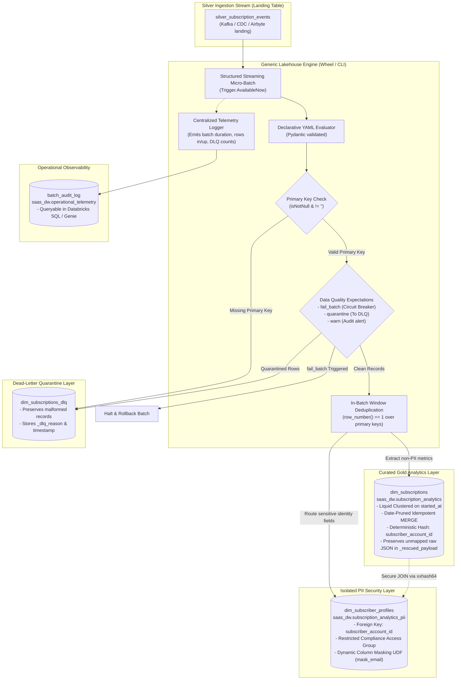

# Databricks Lakehouse Metadata-Driven ETL Boilerplate

[](LICENSE)
[](pyproject.toml)
[](terraform/modules/databricks_job/variables.tf)
[](terraform/main.tf)

A production-ready, metadata-driven framework for building scalable **Medallion Lakehouse Architectures** on Databricks.

Instead of writing bespoke, repetitive pipeline code and compiling monolithic binaries for every new entity, this framework uses **declarative YAML definitions** evaluated by a generic, optimized PySpark streaming engine with **automated PII segregation**, **Databricks Liquid Clustering**, **declarative data quality expectations (circuit breakers)**, **Dead-Letter Queue (DLQ) quarantine**, **historical backfills**, **centralized micro-batch telemetry**, and **Databricks Genie AI semantic enrichment**.

Works identically across **Databricks Enterprise (Unity Catalog)**, **Databricks Community Edition (100% Free Tier)**, and **local laptop PySpark environments**.

---

## 🎯 Architecture Diagram

### 1. Medallion Data Flow with DLQ, Data Quality Expectations & PII Split



---

## 🛡️ Enterprise Hardening & Governance Features

1. **Declarative Data Quality Expectations (Phase 2)**:
   - Configure validation rules directly in YAML:
     - `fail_batch`: Halts processing immediately on severe data violations (circuit breaker).
     - `quarantine`: Diverts rows violating rules (e.g. invalid status codes) to DLQ while allowing valid rows through.
     - `warn`: Logs alerts and records telemetry without dropping records.
2. **Historical Backfill CLI (Phase 2)**:
   - Reprocess historical date windows without corrupting streaming checkpoint offsets:
     ```bash
     lakehouse-engine backfill --config-path configs/examples/subscriptions.yml --start-date 2026-01-01 --end-date 2026-03-31
     ```
3. **Zero Data Loss via Dead-Letter Queue (DLQ) (Phase 1)**:
   - Segregates bad records to `<target_table>_dlq` tagged with `_dlq_reason` and `_dlq_timestamp`.
4. **Raw Payload Preservation (`_rescued_payload`) (Phase 1)**:
   - Preserves unmapped incoming JSON keys in `_rescued_payload` to eliminate silent loss during schema drift.
5. **Centralized Operational Telemetry (Phase 1)**:
   - Automatically logs rows read, inserted, updated, and duration to a queryable Delta audit table.
6. **Automated Semantic Catalog for Databricks Genie**:
   - Compiles Unity Catalog `NOT ENFORCED` constraints and canonical metric formulas for conversational text-to-SQL.

---

## 📁 Repository Structure

```text
├── configs/
│   ├── templates/
│   │   └── entity_template.yml    # Scaffolding template for new entities
│   └── examples/
│       └── subscriptions.yml      # Anonymized SaaS subscription + PII profile example
├── context/                       # In-depth architectural context for LLMs & Engineers
│   ├── mcp_server_guide.md        # Model Context Protocol (MCP) server guide
│   ├── databricks_variant_guide.md# Native Databricks binary VARIANT guide
│   ├── phase2_governance_guide.md # Data quality expectations & backfill guide
│   ├── phase1_hardening_guide.md  # DLQ and Operational Telemetry specifications
│   ├── genie_kimball_modeling_guide.md
│   ├── agentic_semantic_catalog.md
│   ├── architecture_overview.md
│   ├── delta_lake_engine_norms.md
│   ├── pii_segregation_patterns.md
│   └── databricks_free_tier_guide.md
├── src/
│   └── lakehouse_engine/
│       ├── cli.py                 # CLI commands: run, backfill, export-genie, mcp-serve
│       ├── mcp/
│       │   └── server.py          # Native Model Context Protocol (MCP) server
│       ├── models/
│       │   └── config.py          # Pydantic schema validation for configs
│       └── core/
│           ├── backfill.py        # Historical batch re-computation engine
│           ├── expectations.py    # Data quality evaluation & circuit breakers
│           ├── audit.py           # Centralized operational telemetry logger
│           ├── dlq.py             # Pre-MERGE validation & DLQ quarantine
│           ├── genie.py           # Genie instructions & constraint DDL compiler
│           ├── delta_ops.py       # Liquid clustering, in-batch dedup, pruned MERGE
│           ├── pii.py             # PII extraction and isolation logic
│           ├── streaming.py       # Micro-batch streaming coordinator
│           └── transformer.py     # SQL expression and attribute evaluator
├── terraform/
│   ├── env_conf/                  # Per-environment variables (dev, prod)
│   ├── modules/
│   │   ├── databricks_job/        # Single-node spot workflow definition
│   │   └── unity_governance/      # Catalog, PII schemas, masking UDFs, ACLs
│   ├── main.tf                    # Root composition
│   └── variables.tf
├── tests/
│   ├── conftest.py                # Local PySpark session fixture
│   ├── test_config.py             # Pydantic YAML schema validation tests
│   ├── test_phase1_dlq_audit.py   # DLQ & Telemetry test assertions
│   └── test_phase2_expectations_backfill.py # Expectations test assertions
├── .mcp.json                      # MCP client config for Cursor, Claude & AI tools
├── CLAUDE.md                      # AI agent coding guidelines & rules
├── pyproject.toml                 # Modern PEP 621 Python packaging
├── Taskfile.yml                   # Unified developer automation commands
└── README.md
```

---

## ⚡ Quickstart: Adding a New Entity in 3 Minutes

### Step 1: Create Entity Config
Copy [configs/templates/entity_template.yml](configs/templates/entity_template.yml) to `configs/examples/subscriptions.yml`:

```yaml
version: "1.0"
entity_name: "subscriptions"

source:
  catalog: "raw_landing"
  schema: "event_stream"
  table: "silver_subscription_events"

runtime:
  trigger_type: "AvailableNow"
  max_mbytes_per_trigger: 2000
  checkpoint_location: "dbfs:/checkpoints/lakehouse_engine/subscriptions"
  audit_table: "saas_dw.operational_telemetry.batch_audit_log"

gold:
  catalog: "saas_dw"
  schema: "subscription_analytics"
  table: "dim_subscriptions"
  unique_keys: ["subscription_id"]
  cluster_by: ["started_at"]
  prune_column: "started_at"
  
  # Phase 1: DLQ & Rescued Data
  enable_dlq: true
  dlq_table: "saas_dw.subscription_analytics.dim_subscriptions_dlq"
  track_rescued_data: true

  # Phase 2: Data Quality Rules
  expectations:
    - name: "valid_mrr"
      expr: "mrr_amount >= 0.0"
      action: "fail_batch"
    - name: "valid_status"
      expr: "status IN ('ACTIVE', 'PAST_DUE', 'CANCELLED', 'PAUSED')"
      action: "quarantine"

  fields:
    - name: "subscription_id"
      type: "string"
      expr: "payload.subscriptionId"
      is_primary_key: true
    - name: "mrr_amount"
      type: "double"
      expr: "cast(payload.plan.amountCents as double) / 100.0"
```

### Step 2: Validate Locally
```bash
task test
```

### Step 3: Run Streaming or Historical Backfill
```bash
# Streaming Run
python3 -m lakehouse_engine.cli run --config-path configs/examples/subscriptions.yml

# Historical Backfill (e.g. Q1 2026)
python3 -m lakehouse_engine.cli backfill --config-path configs/examples/subscriptions.yml --start-date 2026-01-01 --end-date 2026-03-31
```

---

## 🛠️ Developer Commands (`Taskfile.yml`)

| Command | Description |
| :--- | :--- |
| `task install` | Installs local Python environment and dev dependencies |
| `task test` | Runs unit tests with `pytest` |
| `task lint` | Runs `ruff` linter and `mypy` type checking |
| `task format` | Formats code with `ruff` |
| `task build` | Builds the lightweight `.whl` package to `dist/` |
| `task genie:export` | Compiles Genie Space instructions & UC constraint DDLs |
| `task backfill CONFIG=...` | Runs historical batch backfill |
| `task tf:plan ENV=dev` | Runs `terraform plan` against specified environment |
| `task tf:apply ENV=prod` | Deploys Terraform resources to specified environment |

---

## 📄 License
Licensed under the [Apache-2.0 License](LICENSE).
