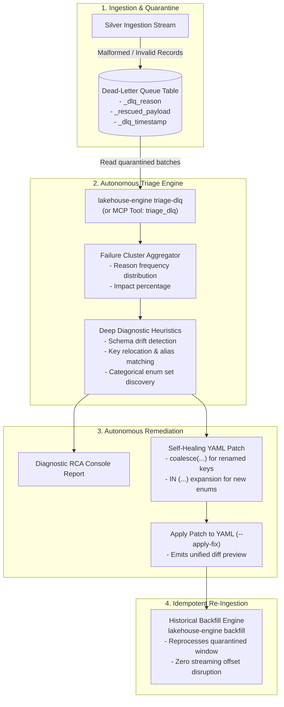

# Autonomous Self-Healing DLQ Triage Guide

This architectural guide explains the **Autonomous Self-Healing Dead-Letter Queue (DLQ) Triage Engine** (`lakehouse-engine triage-dlq`), transforming the traditional "DLQ graveyard" into an autonomous operational SRE loop.

---

## 1. The Operational Challenge: The "DLQ Graveyard"

In traditional streaming data architectures:
1. When upstream systems drift (e.g. Stripe renames a payload key from `subscriptionId` to `sub_id`, or introduces a new enum `PENDING_REVIEW`), data pipelines divert records to a DLQ table.
2. Bad data accumulates silently in the DLQ.
3. Days or weeks later, downstream reporting reports missing revenue or dropped customers.
4. An on-call data engineer is forced to manually write JSON queries, reverse-engineer nested payload differences, draft a code fix, re-deploy, and manually restate data.

---

## 2. The Autonomous Self-Healing Loop

The Lakehouse Engine implements an automated 4-stage diagnostic loop:



---

## 3. Diagnostic Capabilities

| Failure Category | Detection Mechanism | Autonomous Remediation |
| :--- | :--- | :--- |
| **Primary Key Schema Drift**<br/>`MISSING_OR_EMPTY_KEY:<key>` | Inspects `_rescued_payload` for candidate key attributes (e.g. `sub_id` vs `subscription_id`), excluding fields already claimed by other schema columns. | Generates a non-breaking `coalesce(payload.existing_key, payload.new_key)` expression patch. |
| **New Categorical Enum Values**<br/>`FAILED_EXPECTATION:<name>` | Extracts violating values from quarantined rows (e.g. `status == 'PENDING_REVIEW'`), parses the allowed set in the expectation rule, and computes the expanded set. | Automatically extends the `expr` definition (e.g. `status IN ('ACTIVE', ..., 'PENDING_REVIEW')`). |
| **Truly Absent Keys** | Verifies that no key candidates exist across all payloads in the batch. | Flags records as dropped events and suggests source-level `stream_filter_field` configuration. |

---

## 4. Usage Guide

### A. Run Triage on Databricks Delta Table (Spark Active)
```bash
python3 -m lakehouse_engine.cli triage-dlq \
  --config-path configs/examples/subscriptions.yml \
  --limit 500
```

### B. Run Offline / Locally with Sample DLQ Records
```bash
python3 -m lakehouse_engine.cli triage-dlq \
  --config-path configs/examples/subscriptions.yml \
  --sample-file configs/examples/sample_dlq_records.json
```

### C. Automatically Apply Patch to Config
```bash
python3 -m lakehouse_engine.cli triage-dlq \
  --config-path configs/examples/subscriptions.yml \
  --sample-file configs/examples/sample_dlq_records.json \
  --apply-fix
```

### D. Via Model Context Protocol (MCP) Server for AI Agents
Any AI assistant connected via `.mcp.json` can invoke the native `triage_dlq` tool:
```json
{
  "name": "triage_dlq",
  "arguments": {
    "config_path": "configs/examples/subscriptions.yml",
    "dlq_records": [ ... ],
    "apply_fix": true
  }
}
```

---

## 5. End-to-End Self-Healing Workflow

```bash
# 1. Run Autonomous Triage and review diagnosis
task dlq:triage SAMPLE=configs/examples/sample_dlq_records.json

# 2. Apply self-healing patch
python3 -m lakehouse_engine.cli triage-dlq \
  --config-path configs/examples/subscriptions.yml \
  --sample-file configs/examples/sample_dlq_records.json \
  --apply-fix

# 3. Validate updated schema passes all tests
task test

# 4. Re-run historical backfill to clear DLQ backlog
task backfill CONFIG=configs/examples/subscriptions.yml START=2026-10-01 END=2026-10-31
```
