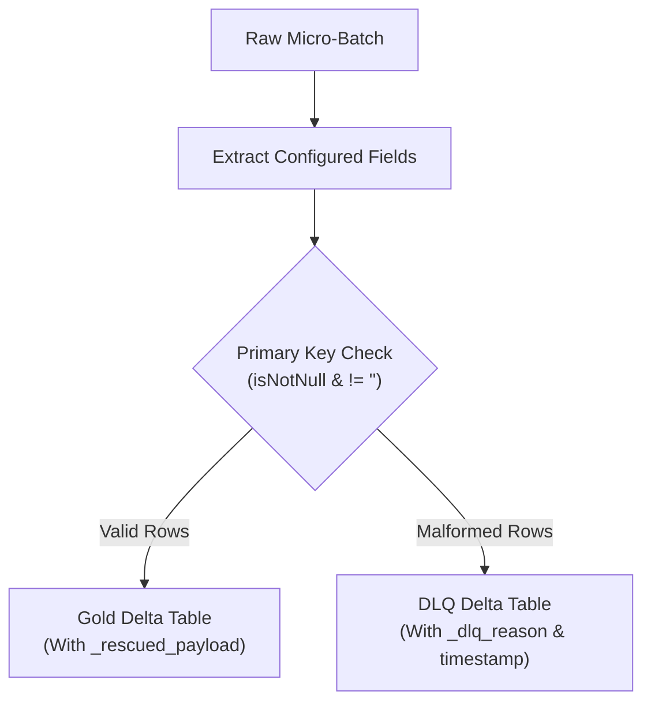

# Dead-Letter Queue (DLQ) & Operational Telemetry Guide

This document details the two operational reliability pillars of the Lakehouse Engine:
1. **Zero Data Loss via Dead-Letter Queue (DLQ) & `_rescued_payload`**
2. **Centralized Micro-Batch Operational Telemetry Audit Logging**

---

## 1. Dead-Letter Queue (DLQ) & Rescued Data

### The Problem in Traditional Pipelines:
When upstream sources change, introduce bad data, or emit records with missing/null primary keys:
- The streaming job either crashes with a `DELTA_MERGE_UNRESOLVED_EXPRESSION` or non-null violation.
- Or worse, the pipeline silently drops the bad records without an audit trail, causing silent revenue/data loss.

### The Lakehouse Engine Solution:
1. **Pre-MERGE Validation**: Inside each micro-batch, `src/lakehouse_engine/core/dlq.py` inspects the transformed dataset.
2. **Automatic DLQ Splitting**:
   - Records with valid primary keys proceed to the Gold Delta MERGE.
   - Records with missing or empty primary keys are automatically segregated into `<target_table>_dlq`.
3. **Quarantine Metadata Injected**:
   - `_dlq_reason`: Exact cause (e.g., `MISSING_OR_EMPTY_KEY:subscription_id`).
   - `_dlq_timestamp`: Timestamp when quarantined.
4. **`_rescued_payload` Column**:
   - When `track_rescued_data: true`, the engine preserves the complete unmapped raw JSON payload in a dedicated `_rescued_payload` column in Gold.
   - If upstream adds a new field (e.g. `cancellation_reason`), the data is safely preserved until declared in YAML.



---

## 2. Centralized Micro-Batch Operational Telemetry

### The Problem:
Standard Databricks cluster logs and stdout prints do not provide queryable historical telemetry. You cannot answer:
- *"How many rows were inserted vs. updated yesterday?"*
- *"Did merge times start degrading after last week's backfill?"*
- *"Which entity had the highest DLQ quarantine rate?"*

### The Solution:
Every micro-batch emits structured metrics to the centralized audit Delta table configured in `runtime.audit_table`:

| Column | Type | Description |
| :--- | :--- | :--- |
| `batch_id` | `BIGINT` | Spark Structured Streaming micro-batch ID |
| `entity_name` | `STRING` | Entity identifier (e.g. `subscriptions`) |
| `target_table` | `STRING` | Target Delta table FQDN |
| `batch_timestamp` | `TIMESTAMP` | Timestamp when the batch executed |
| `execution_duration_ms` | `BIGINT` | Total micro-batch duration in milliseconds |
| `source_rows_read` | `BIGINT` | Raw row count read from the incoming stream |
| `target_rows_inserted` | `BIGINT` | Extracted directly from Delta commit `operationMetrics` |
| `target_rows_updated` | `BIGINT` | Extracted directly from Delta commit `operationMetrics` |
| `dlq_rows_quarantined` | `BIGINT` | Number of invalid rows sent to DLQ |
| `status` | `STRING` | `SUCCESS` or `FAILED` |
| `error_message` | `STRING` | Error stack trace if failed |

### Querying Telemetry in Databricks SQL / Genie:
```sql
SELECT 
    entity_name,
    date_trunc('hour', batch_timestamp) AS hour,
    sum(source_rows_read) AS total_read,
    sum(target_rows_inserted) AS total_inserted,
    sum(target_rows_updated) AS total_updated,
    sum(dlq_rows_quarantined) AS total_quarantined,
    avg(execution_duration_ms) / 1000.0 AS avg_duration_sec
FROM saas_dw.operational_telemetry.batch_audit_log
GROUP BY 1, 2
ORDER BY 2 DESC;
```
