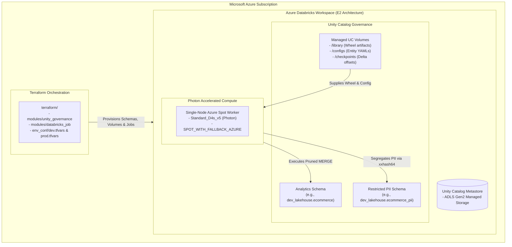

# Azure Databricks Production Guide

**[About](index.md)** | **[Azure Guide](azure_production_guide.md)** | **[Production Guide](production_adoption_guide.md)** | **[Limitations](limitations.md)** | **[Pros & Cons](pros_and_cons.md)** | **[Examples](examples.md)** | **[GitHub Repository](https://github.com/anilkulkarni87/databricks-lakehouse-boilerplate)**

---

This runbook provides the **bulletproof, end-to-end production sequence** for adopting **Lakehouse Engine** on **Azure Databricks** with Unity Catalog, Terraform infrastructure-as-code, Azure Spot cost optimization, and automated CI/CD deployment.

---

## 🏛️ Azure Architecture Overview



---

## 📋 Prerequisites

1. **Azure Databricks Workspace** with **Unity Catalog** enabled.
2. **Target Unity Catalog**: (e.g., `main`, `dev_lakehouse`, or `prod_lakehouse`) with `CREATE SCHEMA` permissions.
3. **Local Tools**:
   * [Task](https://taskfile.dev/) (`brew install go-task`)
   * [Terraform](https://www.terraform.io/) `>= 1.5.0`
   * [Databricks CLI](https://docs.databricks.com/dev-tools/cli/index.html) `>= 0.200.0`
   * Python 3.10 or 3.11

---

## 🚀 The Bulletproof 7-Step Adoption Sequence

### Step 1: Switch to Azure Terraform Branch & Build Artifacts
Switch to the Azure-specific Terraform branch and build the lightweight wheel:
```bash
# 1. Switch to the dedicated Azure Terraform branch
git checkout feature/azure-databricks-terraform

# 2. Build the production wheel artifact
task build
# Generates: dist/lakehouse_engine-0.1.0-py3-none-any.whl (41 KB)
```

---

### Step 2: Configure Workspace Authentication
Export credentials in your deployment terminal:
```bash
# Your Azure Databricks workspace URL
export DATABRICKS_HOST="https://adb-1234567890123456.dev.azuredatabricks.net"

# Option A: Personal Access Token (for initial sandbox testing)
export DATABRICKS_TOKEN="dapi1234567890abcdef..."

# Option B: Azure Service Principal (Enterprise CI/CD Standard)
export ARM_CLIENT_ID="<azure-service-principal-client-id>"
export ARM_CLIENT_SECRET="<azure-service-principal-client-secret>"
export ARM_TENANT_ID="<azure-active-directory-tenant-id>"
```

---

### Step 3: Configure Environment Variables in `dev.tfvars`
Edit [`terraform/env_conf/dev.tfvars`](https://github.com/anilkulkarni87/databricks-lakehouse-boilerplate/blob/feature/azure-databricks-terraform/terraform/env_conf/dev.tfvars):
```hcl
databricks_host = "https://adb-1234567890123456.dev.azuredatabricks.net"
environment     = "dev"
cloud_provider  = "azure"
catalog_name    = "dev_lakehouse"             # Your Azure UC Catalog
domain_name     = "ecommerce"                 # Target Schema Domain
node_type_id    = "Standard_D4s_v5"           # Azure Photon-capable VM
manage_grants   = false                       # Set true once user groups exist
```

---

### Step 4: Provision Infrastructure with Terraform
Initialize and apply the Terraform configuration:
```bash
cd terraform

# 1. Initialize Databricks provider
terraform init

# 2. Preview resources
terraform plan -var-file="env_conf/dev.tfvars"

# 3. Apply infrastructure
terraform apply -var-file="env_conf/dev.tfvars" -auto-approve
```

#### What Terraform Provisions in Azure Databricks:

| Resource | Name / Location | Purpose |
| :--- | :--- | :--- |
| **Standard Schema** | `dev_lakehouse.ecommerce` | Curated non-PII Gold dimensions and facts. |
| **PII Schema** | `dev_lakehouse.ecommerce_pii` | Restricted compliance layer with column masking. |
| **Library Volume** | `/Volumes/dev_lakehouse/ecommerce/library` | Staging location for the engine Python wheel. |
| **Configs Volume** | `/Volumes/dev_lakehouse/ecommerce/configs` | Staging location for Git-versioned entity YAMLs. |
| **Checkpoints Volume** | `/Volumes/dev_lakehouse/ecommerce/checkpoints` | Streaming checkpoint offsets. |
| **Masking Function** | `dev_lakehouse.ecommerce_pii.mask_email` | Dynamic SQL UDF masking emails for non-privileged users. |
| **Workflow Job** | `lakehouse-subscriptions-dev` | Photon single-node Azure Spot job executing `python_wheel_task`. |

---

### Step 5: Pre-Flight Linting, Secret Scopes & Artifact Upload
Before uploading configurations, verify safety guardrails and configure Azure Key Vault secret scopes:

```bash
# Return to repository root
cd ..

# 1. Pre-flight verify configurations against production safety guardrails
task config:lint

# 2. (Optional) Link Azure Key Vault as a Databricks Secret Scope
databricks secrets create-scope \
  --scope lakehouse_secrets \
  --scope-backend-type AZURE_KEYVAULT \
  --resource-id "/subscriptions/<AZURE_SUB_ID>/resourceGroups/<RG>/providers/Microsoft.KeyVault/vaults/<KV_NAME>" \
  --dns-name "https://<KV_NAME>.vault.azure.net/"

# 3. Upload Wheel Artifact
databricks fs cp dist/lakehouse_engine-*.whl \
  dbfs:/Volumes/dev_lakehouse/ecommerce/library/lakehouse_engine-0.2.0-py3-none-any.whl

# 4. Upload Entity YAML Config
databricks fs cp configs/examples/subscriptions.yml \
  dbfs:/Volumes/dev_lakehouse/ecommerce/configs/subscriptions.yml
```

---

### Step 6: Seed Silver Landing Table & Execute Job
In Databricks SQL or a scratch notebook, seed the landing table:

```sql
CREATE SCHEMA IF NOT EXISTS dev_lakehouse.raw_landing;

CREATE TABLE IF NOT EXISTS dev_lakehouse.raw_landing.silver_subscription_events (
  subscriptionId STRING,
  plan STRUCT<tier: STRING, billingInterval: STRING, amountCents: BIGINT>,
  currency STRING,
  status STRING,
  isTrial BOOLEAN,
  autoRenew BOOLEAN,
  renewalCount INT,
  startedOn TIMESTAMP,
  updatedOn TIMESTAMP,
  subscriberId STRING,
  subscriber STRUCT<email: STRING, contactName: STRING, phone: STRING, taxIdentifier: STRING, country: STRING, postalCode: STRING>,
  raw_device_headers STRING
) USING DELTA;

INSERT INTO dev_lakehouse.raw_landing.silver_subscription_events VALUES (
  'sub_1001',
  named_struct('tier', 'Pro', 'billingInterval', 'monthly', 'amountCents', 4900),
  'USD',
  'ACTIVE',
  false,
  true,
  3,
  current_timestamp(),
  current_timestamp(),
  'cust_901',
  named_struct('email', 'alex.miller@example.com', 'contactName', 'Alex Miller', 'phone', '+1-555-0123', 'taxIdentifier', 'US-9912', 'country', 'US', 'postalCode', '98101'),
  '{"user_agent": "Mozilla/5.0 (Azure-Client)", "ip": "10.0.0.1", "dark_mode": true}'
);
```

#### Trigger the Terraform-Managed Job:
1. Navigate to **Workflows** $\rightarrow$ **Jobs** in Azure Databricks.
2. Select **`lakehouse-subscriptions-dev`** $\rightarrow$ click **Run Now**.
3. Inspect Job Run Logs:
   * **Clean Ingestion**: Merges into `dev_lakehouse.ecommerce.dim_subscriptions`.
   * **PII Isolation**: Customer email routes to `dev_lakehouse.ecommerce_pii.dim_subscriber_profiles_pii`.
   * **Telemetry**: Micro-batch latency and row counts logged to `dev_lakehouse.ecommerce.pipeline_batch_audit`.

---

### Step 7: Onboarding New Pipeline Jobs & Handling Domain Changes

In an enterprise environment, jobs frequently belong to different business domains (e.g., `ecommerce`, `finance`, `marketing`, `gaming`). 

#### Decoupling Domains per Job (Avoiding the Single-Domain Trap):
Instead of tying all jobs to a single global `domain_name` in `dev.tfvars`, the `databricks_job` module allows **explicit per-job domain mapping**:

```hcl
module "subscriptions_pipeline_job" {
  source               = "./modules/databricks_job"
  job_name             = "lakehouse-subscriptions"
  environment          = var.environment
  cloud_provider       = var.cloud_provider
  catalog_name         = var.catalog_name
  
  # Explicit Domain & Auto-Resolved Config:
  domain               = "finance"            # Overrides default domain!
  config_file_name     = "subscriptions.yml"  # Auto-resolves: /Volumes/${catalog}/finance/configs/subscriptions.yml
  
  node_type_id         = var.node_type_id
  service_principal_id = var.service_principal_id
  data_security_mode   = "SINGLE_USER"
  max_retries          = 3
  schedule_cron        = "0 15 * * * ?"
  
  custom_tags = {
    "lakehouse.jobName"     = "subscriptions-shared"
    "lakehouse.alertThresholdHours" = "24"
  }
}
```

#### Enterprise Single-User & Unity Catalog Cluster Specs:
The `databricks_job` module implements the standard enterprise single-node pattern:
* **Zero Workers (`num_workers = 0`)**: Uses single-node local execution (`local[*,4]`) for low-cost micro-batching.
* **Unity Catalog Compliance (`data_security_mode = "SINGLE_USER"`)**: Ensures fine-grained Unity Catalog data governance when executed by a service principal.
* **Spark Optimization Flags**:
  * `spark.databricks.dataLineage.enabled: "true"`
  * `spark.databricks.delta.optimizeWrites.enabled: "true"`
  * `spark.sql.files.ignoreMissingFiles: "true"`
  * `spark.scheduler.mode: "FIFO"`

#### Day-2 Deployment Patterns for New Entities:

##### Pattern A: Dynamic Parameterization (Fastest — Zero Terraform Changes)
1. Commit `configs/entities/orders.yaml` to Git under domain `ecommerce`.
2. CI/CD syncs the YAML to `/Volumes/dev_lakehouse/ecommerce/configs/orders.yaml`.
3. Trigger the universal runner passing `--config-path /Volumes/.../orders.yaml`.
*Onboarding Time*: Under 2 minutes.

##### Pattern B: Dedicated Terraform Job (Isolated Compute & Custom Crons)
Add a new module block in `terraform/main.tf` specifying the entity domain, schedule, and tags:
```hcl
module "orders_pipeline_job" {
  source               = "./modules/databricks_job"
  job_name             = "lakehouse-orders"
  environment          = var.environment
  cloud_provider       = var.cloud_provider
  catalog_name         = var.catalog_name
  domain               = "ecommerce"
  config_file_name     = "orders.yml"
  node_type_id         = "Standard_D4s_v5"
  service_principal_id = var.service_principal_id
  schedule_cron        = "0 30 * * * ?" # Runs at :30 past every hour
}
```
Run `terraform apply -var-file="env_conf/dev.tfvars"` to provision the new scheduled job.

---

## 🛡️ Production Best Practices on Azure

1. **Always Use Photon & Azure Spot**:
   * The `databricks_job` module sets `runtime_engine = "PHOTON"` and `availability = "SPOT_WITH_FALLBACK_AZURE"`. This reduces Azure compute bills by up to **70%** compared to on-demand VMs while preventing job halts if spot capacity is briefly constrained.
2. **Never Use DBFS Root Paths**:
   * Azure Databricks workspaces with modern Unity Catalog enforce `DBFS_DISABLED`. Always use managed Unity Catalog Volumes (`/Volumes/<catalog>/<schema>/<volume>/...`) for checkpoints and libraries.
3. **Automate Quality Gates in CI**:
   * Run `task test` and schema validation in your Azure DevOps or GitHub Actions pipeline before applying Terraform in production.
