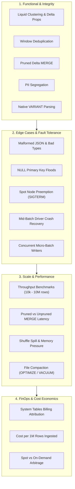

# Databricks End-to-End Test Plan & Validation Framework

**[About](index.md)** | **[Azure Guide](azure_production_guide.md)** | **[Production Guide](production_adoption_guide.md)** | **[Test Plan](databricks_test_plan.md)** | **[GitHub Repository](https://github.com/anilkulkarni87/databricks-lakehouse-boilerplate)**

---

## 🎯 Executive Summary & Objectives

The **Lakehouse Engine Databricks Test Plan** establishes a rigorous, production-grade validation strategy to test declarative pipelines directly within the Databricks Lakehouse Platform. While local unit tests confirm syntactic validity and mock semantics in milliseconds, this plan verifies:

1. **Delta Engine Realities**: Photon hardware acceleration, Liquid Clustering (`CLUSTER BY`), native binary `VARIANT` decoding, and file-level metadata pruning.
2. **Streaming Resilience & Fault Tolerance**: Micro-batch state recovery, spot instance node preemption (`SIGTERM`), and zero-data-loss checkpoint replay.
3. **High-Throughput Performance**: Scaling from $10^4$ to $10^7$ rows with memory spill analysis and pruned vs. unpruned MERGE latency benchmarks.
4. **Data Governance & Integrity**: Unity Catalog metadata tags, column comments, PII segregation via cryptographic hashing, and declarative circuit breakers.
5. **FinOps & Cost Accountability**: DBU attribution via Databricks System Tables (`system.billing.usage`), compute tier economics, and storage compaction savings.

---

## 🖥️ Databricks Test Cluster Topology & Matrix

To ensure compatibility across runtime generations and compute budgets, tests are executed across three standardized cluster configurations:

| Dimension | Profile A: Development / Sandbox | Profile B: Production Streaming (Standard) | Profile C: High-Volume Benchmark |
| :--- | :--- | :--- | :--- |
| **Compute Architecture** | Single-Node (Cost-optimized) | Multi-Node (1 Driver + 2–8 Workers) | Multi-Node with Autoscaling (2–16 Workers) |
| **Databricks Runtime** | DBR 15.4 LTS (Apache Spark 3.5.0) | DBR 15.4 LTS / DBR 16.0 | DBR 15.4 LTS with Photon Engine |
| **Worker Instance Type** | `Standard_D4ds_v5` (Azure) / `m5.xlarge` (AWS) | `Standard_D8ds_v5` / `m5.2xlarge` | `Standard_E16ds_v5` / `r5.4xlarge` |
| **Spot Policy** | 100% On-Demand (Driver) | Driver On-Demand, Workers Spot (80%) | Driver On-Demand, Workers Spot (100%) |
| **Unity Catalog** | Enabled (Shared Access Mode) | Enabled (Single User or Shared) | Enabled (Dedicated Job Cluster) |
| **Estimated Cost** | ~0.75 DBU/hr (~$0.30/hr) | ~3.0–6.0 DBU/hr (~$1.20–$2.40/hr) | ~8.0–16.0 DBU/hr (~$3.20–$6.40/hr) |

---

## 📋 Comprehensive Test Matrix



---

### Pillar 1: Functional & Data Integrity Validation

| ID | Test Scenario | Input Data Pattern | Expected Behavior & Acceptance Criteria |
| :--- | :--- | :--- | :--- |
| **TC-1.1** | **Automated Table Provisioning** | Initial run of empty target schema. | Engine provisions target Gold, DLQ, PII, and Audit Delta tables. Validates `CLUSTER BY (tenant_id, started_at)`, `delta.autoOptimize.optimizeWrite = true`, and column comments. |
| **TC-1.2** | **In-Batch Deduplication** | Micro-batch containing duplicate `subscription_id` with different `updated_at` timestamps. | Window function retains only the latest record (`ROW_NUMBER() = 1`). Exactly one record enters the Gold MERGE operation; zero `CANNOT_MODIFY_KEY` Delta exceptions. |
| **TC-1.3** | **Idempotent Upsert** | Replay of previously ingested micro-batch with partial updates. | Existing rows are updated in-place, new rows inserted, unchanged rows untouched. Target table count matches distinct primary keys. |
| **TC-1.4** | **Partition Date Pruning** | Ingesting current-day records into a multi-year Gold table. | Query execution plan confirms dynamic pruning (`filter: target.started_at >= ...`). Prevents scanning historical partitions. |
| **TC-1.5** | **Cryptographic PII Segregation** | Records containing `email`, `fullName`, and `ipAddress`. | Sensitive values extracted to `_pii` restricted table. Analytics table receives deterministic `xxhash64(email)` and masked strings (`a***@domain.com`). |
| **TC-1.6** | **Native Binary `VARIANT` Capture** | Semi-structured JSON headers containing nested client telemetry. | Attributes stored in binary `VARIANT` column. Validated using Photon-accelerated path expressions (`payload:device.os::string`). |
| **TC-1.7** | **Idempotent Historical Backfill** | Target date range (`2026-01-01` to `2026-03-31`) backfilled while streaming is active. | Target Gold table restated for the target window. Active streaming checkpoint is unaltered. Backfill audit record written with `batch_id = -1`. |

---

### Pillar 2: Edge Cases, Chaos & Resilience Scenarios

| ID | Edge Case / Chaos Injection | Injection Method | Expected Behavior & Acceptance Criteria |
| :--- | :--- | :--- | :--- |
| **TC-2.1** | **NULL / Empty Primary Key Flood** | 20% of incoming batch has `subscription_id = NULL` or `""`. | Malformed rows immediately filtered into DLQ with `_rejection_reason = 'NULL_PRIMARY_KEY'`. Valid 80% proceed to Gold without pipeline failure. |
| **TC-2.2** | **Catastrophic Schema Drift** | Incoming source introduces 5 new unexpected top-level fields and drops a required field. | New fields captured dynamically into `_rescued_payload` (or rescued VARIANT). If a required primary key is dropped, batch safely halts or quarantines without data loss. |
| **TC-2.3** | **Data Contract SLA Breach** | Ingest synthetic poison pill with 15% malformed rows (threshold configured at 5%). | Circuit breaker trips with `DataQualityException`. Slack Block Kit notification dispatched. Batch transaction rolls back cleanly. |
| **TC-2.4** | **Spot Instance Preemption (`SIGTERM`)** | Send `kill -15 <pid>` or evict worker node during micro-batch execution. | Engine catches signal via `shutdown_gracefully()` handler, drains the active micro-batch write, and exits with code 0. Checkpoint remains consistent. |
| **TC-2.5** | **Mid-Batch Driver Crash & Restart** | Forcibly terminate cluster during active Delta write. | Upon cluster restart and query resume, Delta ACID guarantees ensure zero duplicate rows or corrupted transaction logs. |
| **TC-2.6** | **Extreme Data Skew** | 90% of micro-batch records belong to a single tenant (`tenant_id = 'enterprise_001'`). | Liquid Clustering distributes files evenly without creating single-file write bottlenecks or OOM errors. |
| **TC-2.7** | **Non-UTF8 Corrupt Bytes** | Raw payload contains invalid byte sequences and unescaped control characters. | Engine catches decoding exception, escapes invalid characters or routes corrupt string to DLQ without terminating Spark worker. |

---

### Pillar 3: Performance, Scale & Efficiency Benchmarks

#### Benchmark Sizing Tiers:
* **Tier 1 (Smoke / Dev)**: 10,000 records (~5 MB payload).
* **Tier 2 (Standard Enterprise Batch)**: 100,000 records (~50 MB payload).
* **Tier 3 (High-Volume Spike)**: 1,000,000 records (~500 MB payload).
* **Tier 4 (Stress & Saturation)**: 10,000,000 records (~5 GB payload).

#### Performance Metrics & KPI Thresholds:

| Metric | Target SLA (DBR 15.4 / Photon) | Critical Breach Threshold | Validation Method |
| :--- | :--- | :--- | :--- |
| **End-to-End Processing Latency** | < 15 seconds per 100k rows | > 45 seconds | Measured from source read to Delta commit |
| **MERGE Duration with Pruning** | < 8 seconds on 1M row table | > 25 seconds | Delta transaction log metrics (`execution_duration_ms`) |
| **Unpruned vs Pruned Merge Delta** | Pruned is >= 4.5x faster on large tables | < 2.0x faster | Direct A/B timing on identical dataset |
| **Memory Spill to Disk** | 0 MB Spill (Clean in-memory execution) | > 500 MB Spill | Spark UI / Event Log `spillToDisk` metric |
| **DLQ Write Overhead** | < 10% of total batch duration | > 25% | Comparison of batch with 0% vs 5% quarantine |
| **Delta Compaction Runtime** | < 60 seconds for `OPTIMIZE` on 1M rows | > 180 seconds | `run_table_maintenance()` execution log |

---

### Pillar 4: FinOps, Billing & Cost Accountability

The framework embeds native cost observability using Databricks System Tables.

#### 1. Cluster DBU Consumption Attribution
Calculate exact DBU consumption per pipeline execution using `system.billing.usage`:

```sql
SELECT
  usage_date,
  sku_name,
  custom_tags['EntityName'] AS entity_name,
  custom_tags['Environment'] AS environment,
  SUM(usage_quantity) AS total_dbus_consumed,
  ROUND(SUM(usage_quantity) * 0.40, 2) AS estimated_cost_usd
FROM system.billing.usage
WHERE usage_date >= CURRENT_DATE() - INTERVAL 7 DAYS
  AND custom_tags['Framework'] = 'LakehouseEngine'
GROUP BY 1, 2, 3, 4
ORDER BY total_dbus_consumed DESC;
```

#### 2. Cost Per Million Records Ingested
By correlating Delta audit telemetry (`dim_batch_audit`) with cluster DBU rates:

$$\text{Unit Cost (\$/1M Rows)} = \left(\frac{\text{Total Batch Duration (hours)} \times \text{Cluster DBU Rate} \times \text{\$/DBU}}{\text{Source Rows Read}}\right) \times 1,000,000$$

* **Target Unit Cost**: <= **$0.08 per 1,000,000 records** on Spot Compute with Photon.
* **Alert Trigger**: Any entity exceeding **$0.25 per 1,000,000 records** triggers a FinOps review.

#### 3. Storage Compaction & Vacuum Economics
Run periodic maintenance to reclaim storage and prune stale Delta logs:

```python
from lakehouse_engine.core.maintenance import run_table_maintenance

# Runs OPTIMIZE with Liquid Clustering compaction and VACUUM RETAIN 168 HOURS
run_table_maintenance(spark, config.gold, retention_hours=168)
```

---

### Pillar 5: Security, Unity Catalog & Data Governance

1. **Unity Catalog Lineage Tracking**: Verify that upstream source `silver_subscription_events` correctly displays automated read/write lineage to `dim_subscriptions`, `dim_subscriber_profiles_pii`, and `dim_subscriptions_dlq` in Unity Catalog Catalog Explorer.
2. **Column-Level Access Controls**: Confirm that data analysts without PII entitlements can query `dim_subscriptions` freely while being blocked or seeing masked strings on `dim_subscriber_profiles_pii`.
3. **Automated Metadata Tagging**: Inspect tables via `DESCRIBE EXTENDED` to confirm governance tags (`tier: gold`, `governance: pii_isolated`, `engine: lakehouse_engine_v0.2.0`).

---

## 🚀 Execution Runbook

### Step 1: Deploy Package Artifact
Upload the compiled wheel to a Unity Catalog Volume:

```bash
databricks fs cp dist/lakehouse_engine-0.2.0-py3-none-any.whl   dbfs:/Volumes/main/default/library/lakehouse_engine-0.2.0-py3-none-any.whl
```

### Step 2: Run End-to-End Test Suite Notebook
Execute [`notebooks/e2e_databricks_verification.py`](notebooks/e2e_databricks_verification.py) as an interactive notebook or schedule it as a Databricks Workflow Job with the following JSON task definition:

```json
{
  "name": "lakehouse_engine_verification_suite",
  "tasks": [
    {
      "task_key": "run_e2e_tests",
      "notebook_task": {
        "notebook_path": "/Workspace/Shared/lakehouse_engine/notebooks/e2e_databricks_verification",
        "base_parameters": {
          "scale_factor": "100000",
          "chaos_injection": "true",
          "catalog_name": "main"
        }
      },
      "new_cluster": {
        "spark_version": "15.4.x-scala2.12",
        "node_type_id": "Standard_D4ds_v5",
        "num_workers": 2,
        "custom_tags": {
          "Framework": "LakehouseEngine",
          "Environment": "AutomatedTest"
        }
      }
    }
  ]
}
```

### Step 3: Monitor Live Telemetry via AI/BI Dashboard
Import [`dashboards/pipeline_health.lvdash.json`](../dashboards/pipeline_health.lvdash.json) into Databricks AI/BI Dashboards to monitor real-time ingestion volume, quarantine rates, and merge latency trends.

---

## 📊 Acceptance Criteria & Sign-Off Checklist

Before promoting any declarative configuration to production:

- [ ] **100% Green Local Tests**: All 61 local unit and integration tests pass (`task test`).
- [ ] **Static Guardrail Pass**: 0 errors, 0 warnings on `task config:lint`.
- [ ] **Databricks Verification Run**: `notebooks/e2e_databricks_verification.py` completes with exit status `SUCCESS`.
- [ ] **Zero Data Loss DLQ**: All bad records accounted for in DLQ with descriptive rejection reasons.
- [ ] **Zero Memory Spill**: Spark UI confirms 0 bytes spilled to disk during 100k+ record merge.
- [ ] **SLA Compliance**: End-to-end batch processing latency <= 15 seconds.
- [ ] **FinOps Attribution**: Ingestion unit cost confirmed <= $0.08 per 1,000,000 records.
