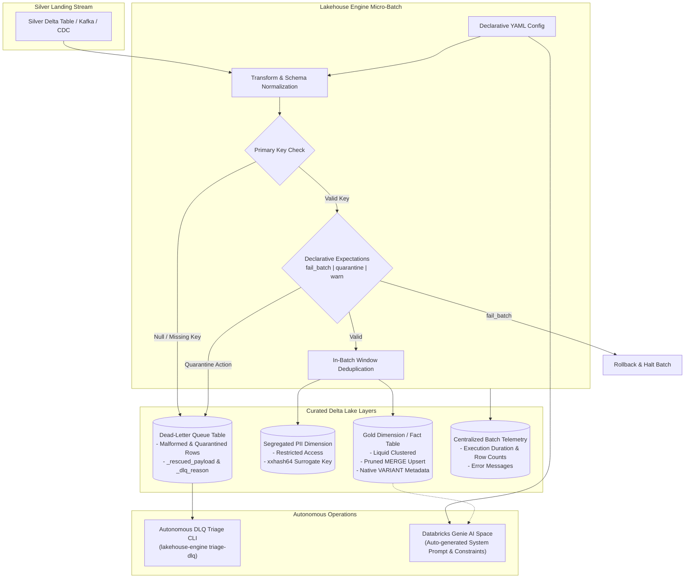

# Lakehouse Engine

**[About](index.md)** | **[Production Guide](production_adoption_guide.md)** | **[Limitations](limitations.md)** | **[Pros & Cons](pros_and_cons.md)** | **[Examples](examples.md)** | **[GitHub Repository](https://github.com/anilkulkarni87/databricks-lakehouse-boilerplate)**

---

## 🌟 About This Repository

**Lakehouse Engine** is an open-source, declarative framework designed for building governed, scalable medallion lakehouses on **Databricks** (Unity Catalog & Community Edition) and Apache Spark.

In traditional data engineering teams, each new business entity requires writing repetitive, bespoke PySpark/SQL scripts to handle ingestion, streaming checkpoints, primary key deduplication, data quality rules, PII isolation, and Dead-Letter Queue (DLQ) routing. This leads to code duplication, schema drift vulnerabilities, and neglected "DLQ graveyards."

**Lakehouse Engine** replaces custom pipeline scripts with **declarative YAML definitions**. A single, generic PySpark streaming engine reads the configuration and executes:
* **Micro-Batch & Streaming Ingestion**: Operates under `Trigger.AvailableNow` (cost-optimized batch) or continuous processing time.
* **Liquid Clustering & Pruned MERGE**: Automatically creates Delta tables with Liquid Clustering (`clusterBy`) and applies intelligent cluster/date pruning during upserts to prevent full-table scans.
* **Automated PII Isolation & Cryptographic Hashing**: Segregates sensitive customer identifiers into restricted compliance tables, linked via deterministic hashing (`xxhash64`).
* **Declarative Data Quality Expectations (Circuit Breakers)**: Enforces business rules with granular actions (`fail_batch`, `quarantine`, `warn`).
* **Zero Data Loss Dead-Letter Queue (DLQ)**: Automatically quarantines malformed or unexpected records and rescues schema drift in `_rescued_payload`.
* **Autonomous Self-Healing DLQ Triage**: Inspects quarantined records, determines root cause failures (schema drift, new categorical values), and generates self-healing YAML patches with an automated `--apply-fix` unified diff generator.
* **Databricks Genie AI Semantic Compiler**: Compiles pipeline metadata into certified system prompts and informational constraints (`NOT ENFORCED`) for Databricks Genie and Text-to-SQL conversational agents.
* **Model Context Protocol (MCP) Server**: Provides native MCP endpoints for AI coding assistants (Claude Desktop, Cursor, Antigravity) to scaffold and validate lakehouse entities.

---

## 🏗️ Architecture & Data Flow

---

## 🧩 Core Capabilities

### 1. Zero-Code Declarative Pipelines
Data engineers declare sources, schema mappings, primary keys, and data quality rules in clean YAML files. The framework dynamically handles type casting, nesting, deduplication, and schema synchronization.

### 2. Autonomous DLQ Triage & Self-Healing
Quarantined records don't rot in a dead-letter queue. The triage engine clusters failures by reason, parses `_rescued_payload` for upstream schema changes, and produces unified diff patches that can be applied automatically via `--apply-fix`.

### 3. Native Binary `VARIANT` Support
Leverages Databricks native binary `VARIANT` data type, hardware-accelerated by the Photon engine, allowing arbitrary semi-structured JSON headers and payloads to be queried directly without JSON string parsing overhead.

### 4. Databricks Genie Semantic Space Compilation
Automatically extracts metrics, primary/foreign keys, and table grains from the YAML definition, generating production-ready Databricks Genie Space instructions and `NOT ENFORCED` SQL constraints.

### 5. Multi-Environment & Free Tier Compatibility
Engineered to work seamlessly across Databricks Community Edition (100% Free Tier) and enterprise workspaces using Unity Catalog Volumes and environment token substitution (`${CATALOG:-main}`).

---

## 📖 Explore Further

* **[Limitations](limitations.md)**: Transparent overview of current engine boundaries and design constraints.
* **[Pros & Cons](pros_and_cons.md)**: Objective evaluation comparing Lakehouse Engine with monolithic scripts and Delta Live Tables.
* **[Working Examples](examples.md)**: Concrete, copy-pasteable configuration files, CLI commands, and SQL queries.
