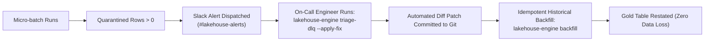

# Production Adoption Guide

**[About](index.md)** | **[Azure Guide](azure_production_guide.md)** | **[Production Guide](production_adoption_guide.md)** | **[Limitations](limitations.md)** | **[Pros & Cons](pros_and_cons.md)** | **[Examples](examples.md)** | **[GitHub Repository](https://github.com/anilkulkarni87/databricks-lakehouse-boilerplate)**

---

This guide provides data engineering teams with a step-by-step production blueprint for deploying, scheduling, and orchestrating **Lakehouse Engine** pipelines using **Terraform**, **Databricks Asset Bundles (DABs)**, and **Git CI/CD**.

---

## 1. Choosing Your Ingestion Model

Lakehouse Engine supports two execution modes configured via the `runtime.trigger_type` YAML property:

| Criteria | Scheduled Micro-Batch (`Trigger.AvailableNow`) | Continuous Streaming (`ProcessingTime`) |
| :--- | :--- | :--- |
| **YAML Config** | `runtime.trigger_type: "AvailableNow"` | `runtime.trigger_type: "10 seconds"` |
| **Cluster Lifecycle** | Starts on schedule, processes all pending data, shuts down. | Runs 24/7 on an always-on cluster. |
| **Compute Cost** | **Ultra-Low**: Zero cost between scheduled runs. | Higher: Incurs compute charges continuously. |
| **Latency** | Minutes to hours (batch SLA). | Sub-minute (real-time streaming). |
| **Ideal For** | CDC syncs, daily/hourly dimensions, SaaS ingestions. | Real-time fraud detection, live telemetry alerts. |

```mermaid
flowchart TD
    subgraph MicroBatch ["Micro-Batch Execution (Trigger.AvailableNow)"]
        Cron["Quartz Cron Trigger\n(e.g., hourly at :15)"] --> Start["Job Cluster Starts (Spot/Photon)"]
        Start --> Ingest["Stream Reads New Delta Offsets"]
        Ingest --> Merge["Pruned MERGE & PII Split"]
        Merge --> Audit["Log Telemetry & Stop"]
        Audit --> Terminate["Cluster Terminates (Zero Idle Cost)"]
    end

    subgraph Continuous ["Continuous Streaming (ProcessingTime)"]
        Source["Kafka / EventHubs / AutoLoader"] --> AlwaysOn["Always-On Cluster (24/7)"]
        AlwaysOn --> Loop["Micro-batch every 10-30s"]
    end
```



---

## 2. Infrastructure-as-Code with Terraform

The repository includes modular Terraform code under [`terraform/`](https://github.com/anilkulkarni87/databricks-lakehouse-boilerplate/tree/main/terraform) to provision Unity Catalog governance and Databricks Jobs.

### Directory Layout
```text
terraform/
├── main.tf                    # Main entry point (calls modules)
├── variables.tf               # Environment input variables
├── env_conf/
│   ├── dev.tfvars             # Development environment parameters
│   └── prod.tfvars            # Production environment parameters
└── modules/
    ├── unity_governance/      # Provision schemas, PII groups, and mask UDFs
    └── databricks_job/        # Provision single-node/multi-node Databricks jobs
```

### Step 1: Provision Unity Catalog Governance & Schemas
The `unity_governance` module automatically provisions:
* Curated standard schema (`var.schema_name`) for non-PII analytics.
* Restricted compliance schema (`${var.schema_name}_pii`) with fine-grained access.
* Access grants for business analysts vs privileged compliance groups.
* Dynamic column masking SQL function (`mask_email`):

```hcl
module "governance" {
  source           = "./modules/unity_governance"
  catalog_name     = var.catalog_name
  schema_name      = var.domain_name
  pii_schema_name  = "${var.domain_name}_pii"
}
```

### Step 2: Provision Scheduled Ingestion Jobs
The `databricks_job` module provisions Photon-accelerated, single-node spot clusters with schedule triggers:

```hcl
module "subscriptions_pipeline_job" {
  source               = "./modules/databricks_job"
  job_name             = "lakehouse-subscriptions"
  environment          = var.environment
  wheel_file_path      = var.wheel_file_path
  config_file_path     = "/Volumes/${var.catalog_name}/${var.domain_name}/configs/subscriptions.yml"
  schedule_cron        = "0 15 * * * ?" # Runs at 15 mins past every hour
}
```

### Step 3: Execute Terraform Deployments
Use the built-in Task runner commands:
```bash
# 1. Initialize Terraform providers
task tf:init

# 2. Plan development deployment
task tf:plan ENV=dev

# 3. Apply to production
task tf:apply ENV=prod
```

---

## 3. Production Deployment Workflows

There are two recommended ways to deploy Lakehouse Engine into production:

### Method A: Databricks Asset Bundles (DABs) — Recommended
Databricks Asset Bundles package code, YAML configs, and job definitions into an automated CI/CD artifact.

1. **Verify Bundle**:
   ```bash
   databricks bundle validate -t prod
   ```
2. **Deploy to Production Workspace**:
   ```bash
   databricks bundle deploy -t prod
   ```
3. **Execute Job**:
   ```bash
   databricks bundle run daily_subscriptions_streaming -t prod
   ```

### Method B: Wheel Packaging & Volume Deployment
If your team manages jobs with Terraform or external orchestrators (Airflow / Digdag):

1. **Build Python Distribution Wheel**:
   ```bash
   task build
   # Generates: dist/lakehouse_engine-0.1.0-py3-none-any.whl
   ```
2. **Upload Artifacts to Unity Catalog Volume**:
   ```bash
   # Upload wheel
   databricks fs cp dist/lakehouse_engine-0.1.0-py3-none-any.whl \
     dbfs:/Volumes/prod_catalog/default/library/lakehouse_engine-0.1.0-py3-none-any.whl

   # Upload Git-versioned entity YAML configs
   databricks fs cp configs/examples/subscriptions.yml \
     dbfs:/Volumes/prod_catalog/default/configs/subscriptions.yml
   ```
3. **Execute via CLI**:
   ```bash
   python -m lakehouse_engine.cli run \
     --config-path /Volumes/prod_catalog/default/configs/subscriptions.yml \
     --env prod
   ```

---

## 4. Multi-Environment Tokenization (Git-Centric)

Never duplicate YAML configuration files per environment. Use token interpolation in your Git repository:

```yaml
version: "1.0"
entity_name: "subscriptions"

source:
  catalog: "${CATALOG:-main}"
  schema: "raw_landing"
  table: "silver_subscription_events"

runtime:
  trigger_type: "AvailableNow"
  checkpoint_location: "${CHECKPOINT_ROOT:-/Volumes/main/default}/checkpoints/subscriptions"
  audit_table: "${CATALOG:-main}.default.pipeline_batch_audit"
  alert_webhook:
    enabled: true
    url: "${SLACK_WEBHOOK_URL}"
    channel: "#lakehouse-alerts"
    min_quarantined_threshold: 1

gold:
  catalog: "${CATALOG:-main}"
  schema: "default"
  table: "dim_subscriptions"
  unique_keys: ["subscription_id"]
```

When promoting through environments:
* **Dev**: `CATALOG=dev_catalog`, `CHECKPOINT_ROOT=/Volumes/dev_catalog/default`
* **Prod**: `CATALOG=prod_catalog`, `CHECKPOINT_ROOT=/Volumes/prod_catalog/default`

---

## 5. Enterprise Hardening: Guardrails, Secrets & Data Contracts

### 5.1 Fail-Fast Config Guardrails CI Gate
Before any configuration is merged or deployed, run the pre-flight safety validator:
```bash
# Run local guardrails verification across all configs
task config:lint

# Or invoke the CLI directly
lakehouse-engine lint-config configs/ --strict
```

The guardrails validator checks:
* ❌ **Unbounded Merge Prevention**: Verifies that every Delta merge (`write_mode: merge`) declares a `prune_column` (e.g. partition date). Full table scans are blocked in CI unless explicitly overridden via `guardrails.allow_unbounded_merge: true` for tiny tables.
* ❌ **Deterministic Deduplication**: Enforces that in-batch deduplication specifies an explicit `order_by_col` or standard timestamp column (`updated_at`, `event_timestamp`) so duplicate records are never dropped non-deterministically.
* ❌ **PII Leakage Scanning**: Scans non-PII Gold tables for unmasked sensitive columns (`email`, `phone`, `ssn`, `tax_id`). Blocks CI in `strict` mode unless fields are moved to `pii_splits` or protected by Unity Catalog column masks.

### 5.2 Secret Scope Resolution (Zero Plaintext Secrets)
Never commit API tokens, passwords, or webhook URLs to Git. Use Databricks Secret Scopes in your YAML configs:
```yaml
secrets:
  slack_webhook: "{{secrets/lakehouse_secrets/slack_webhook}}"

runtime:
  alert_webhook:
    enabled: true
    url: "${secrets.slack_webhook}"
```
* **In Databricks**: Resolves automatically via `dbutils.secrets.get("lakehouse_secrets", "slack_webhook")`.
* **In Local Dev & CI**: Falls back seamlessly to environment variables (`SECRET_LAKEHOUSE_SECRETS_SLACK_WEBHOOK` or `SLACK_WEBHOOK`).

### 5.3 Data Contract SLAs & Quarantine Circuit Breakers
To stop corrupt data upstream from overwhelming downstream analytics, declare a contract SLA:
```yaml
contract:
  schema_drift_policy: "fail_on_incompatible"
  max_quarantine_rate_percent: 5.0     # Maximum acceptable DLQ rate
  quarantine_action: "fail_batch"      # Halt micro-batch if SLA is breached
  enforce_not_null_pk: true
```
If more than 5% of incoming records in a batch fail validation, the engine trips the circuit breaker, halts the batch, logs an audit violation, and dispatches a high-urgency Slack alert.

---

## 6. Operational Observability & Databricks SQL Dashboard

### 6.1 Pre-Built Operational Health Dashboard
Lakehouse Engine includes a pre-configured, production-ready Databricks SQL dashboard definition in [`dashboards/pipeline_health.json`](https://github.com/anilkulkarni87/databricks-lakehouse-boilerplate/blob/main/dashboards/pipeline_health.json).

Import this dashboard into your Databricks SQL workspace for real-time visualization:
1. **Ingestion KPI Summary**: Active batch counts, total ingested, inserted, updated, and quarantined rows over the last 24 hours.
2. **Micro-Batch Ingestion Throughput & Duration**: 15-minute rolling trends for row volume and latency.
3. **Data Contract SLA Compliance**: Micro-batch quarantine rate % plotted directly against the 5.0% contract threshold line.
4. **Top Expectation Violations**: Pie chart breakdown of quarantined root causes from the DLQ table.
5. **Execution Audit Trail**: Live log of all batch statuses, error messages, and commit metrics.

### 6.2 Periodic Storage Maintenance (Small-File Compaction & VACUUM)
To prevent small-file degradation from high-frequency micro-batches and keep cloud storage costs minimal:
```bash
# Run weekly maintenance across Gold, PII, and DLQ tables
lakehouse-engine maintain --config-path configs/examples/subscriptions.yml --retention-hours 168

# Or via Taskfile
task delta:maintain CONFIG=configs/examples/subscriptions.yml HOURS=168
```
This automatically executes:
* `OPTIMIZE`: Coalesces fragmented micro-batch Parquet files and applies Databricks Liquid Clustering sorting.
* `VACUUM ... RETAIN 168 HOURS`: Purges stale unreferenced historical files older than 7 days.

### 6.3 Operational Runbook: Quarantined Records & Incident Response

When bad data or schema drift arrives in production:



1. **Alert Received**: Real-time Slack/Webhook alert fires with quarantined row counts and DLQ table location.
2. **Execute Autonomous Triage**:
   ```bash
   lakehouse-engine triage-dlq -c configs/entities/subscriptions.yaml --apply-fix
   ```
3. **Review & Merge Patch**: Review the unified diff patch (e.g. adding a new allowed status or `coalesce` expression) and commit to Git.
4. **Idempotent Backfill**:
   ```bash
   lakehouse-engine backfill -c configs/entities/subscriptions.yaml -s 2026-10-01 -e 2026-10-23
   ```
5. **Incident Resolved**: The restated records are merged cleanly into Gold without disturbing ongoing streaming checkpoint offsets.
