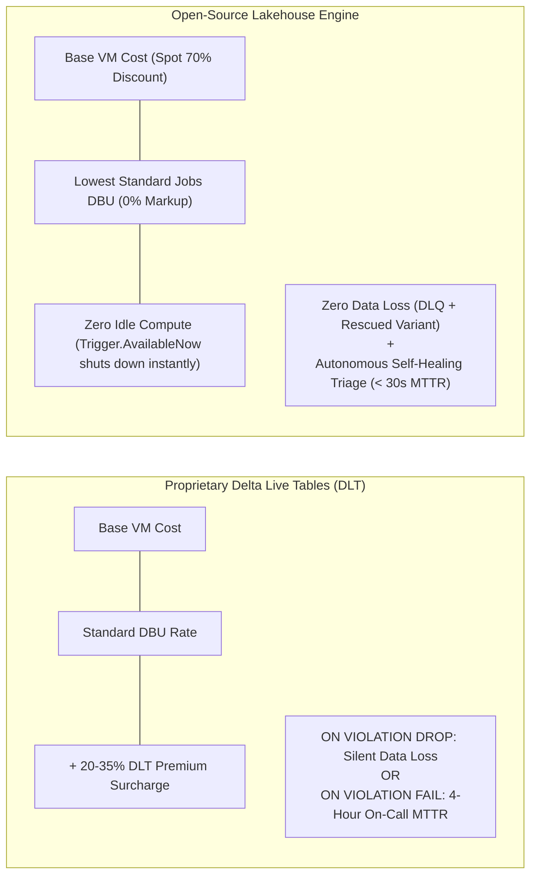

# Pros & Cons

**[About](index.md)** | **[Hardening Roadmap](hardening_roadmap.md)** | **[Azure Guide](azure_production_guide.md)** | **[Production Guide](production_adoption_guide.md)** | **[Limitations](limitations.md)** | **[Pros & Cons](pros_and_cons.md)** | **[Examples](examples.md)** | **[GitHub Repository](https://github.com/anilkulkarni87/databricks-lakehouse-boilerplate)**

---

To help data platform architects and engineering teams evaluate the **Lakehouse Engine**, this document presents an objective comparison between this framework, bespoke handcrafted PySpark scripts, and proprietary alternatives like Delta Live Tables (DLT).

---

## ⚖️ High-Level Comparison Matrix

| Capability | Bespoke PySpark Scripts | Delta Live Tables (DLT) | Lakehouse Engine |
| :--- | :--- | :--- | :--- |
| **Configuration Model** | ❌ Hardcoded code per entity | ⚠️ Python / SQL mix | ✅ Pure Declarative YAML |
| **Dead-Letter Queue (DLQ)** | ❌ Manual boilerplate | ⚠️ Drops or fails batch | ✅ Native with `_rescued_payload` |
| **Self-Healing DLQ Triage** | ❌ Manual investigation | ❌ None | ✅ Automated (`lakehouse-engine triage-dlq`) |
| **Automated PII Splitting** | ❌ Manual dual-stream logic | ❌ Manual table modeling | ✅ Automatic via `xxhash64` surrogate keys |
| **Databricks Genie AI Ready** | ❌ Manual documentation | ⚠️ Manual modeling | ✅ Auto-generates Prompt & Constraints DDL |
| **Free Tier / Local Execution** | ✅ Yes | ❌ Proprietary Databricks feature | ✅ Runs on Free Tier, CE, & Local PySpark |
| **IDE Autocomplete & Linting** | ❌ Varies | ⚠️ Limited YAML schema | ✅ JSON Schema (`.vscode/settings.json`) |
| **Cost Profile** | ⚠️ Unoptimized full table scans | 💲 DLT DBU Premium | 💲 Standard Compute (Zero Premium) |

---

## 🟢 Advantages (Pros)

### 1. Massive Reduction in Code Duplication
* **Fact**: Adding a new entity requires only a 50-line YAML file declaring the schema mapping and expectations.
* **Impact**: Eliminates thousands of lines of boilerplate code across ingestion, deduplication, error handling, and auditing.

### 2. Autonomous DLQ Triage (No DLQ Graveyards)
* **Fact**: Most data engineering DLQs turn into unmonitored storage graveyards.
* **Impact**: The built-in triage engine (`lakehouse-engine triage-dlq`) clusters quarantined rows, decodes rescued JSON payloads, diagnoses root causes (upstream schema drift or missing categorical values), and automatically generates unified diff patches for immediate remediation.

### 3. Native PII Compliance & Governance by Design
* **Fact**: Sensitive customer identifiers (email, phone, tax ID) are automatically separated into restricted tables linked by deterministic surrogate keys (`xxhash64(cast(id as string))`).
* **Impact**: Data analysts query clean Gold analytics dimensions without compliance risk, while privacy officers grant restricted access to PII tables only to authorized users.

### 4. Zero Proprietary Lock-In & 100% Free Tier Compatible
* **Fact**: Built entirely on open-source libraries: Apache Spark, Delta Lake, Pydantic, and Click.
* **Impact**: Unlike Delta Live Tables, this framework runs on Databricks Community Edition (100% Free Tier), local laptops with PySpark, or standard Databricks jobs without paying specialized DBU tier markups.

### 5. Day-One Databricks Genie AI Adoption
* **Fact**: Automatically compiles metric definitions, grain statements, and table relationships into a certified Databricks Genie Space prompt with `NOT ENFORCED` SQL constraints.
* **Impact**: Business users can ask natural language questions in Genie immediately without hallucinated joins or incorrect business calculations.

---

## 🔴 Disadvantages & Trade-offs (Cons)

### 1. No Visual Drag-and-Drop Pipeline Builder
* **Trade-off**: The engine is code-first and Git-centric. It is configured through YAML and CLI commands rather than a graphical workflow designer.
* **Who it affects**: Non-technical users who require a visual ETL UI.

### 2. Entity-by-Entity Granularity
* **Trade-off**: Each YAML configuration models a single entity pipeline (Source $\rightarrow$ Gold + PII Split).
* **Who it affects**: Complex data warehouse transformations requiring multi-table diamond-dependency DAGs in a single step must be chained via Databricks Workflows or upstream views.

### 3. Requires Understanding of Spark & Delta Semantics
* **Trade-off**: While configuration is in YAML, configuring performance optimizations (Liquid Clustering keys, date-pruning columns, and expectation expressions) requires an understanding of Delta Lake mechanics.
* **Who it affects**: Novice analysts unfamiliar with distributed data concepts.

### 4. PySpark Dependency
* **Trade-off**: Requires a Spark runtime (Databricks cluster, local Spark, or Docker container).
* **Who it affects**: Teams seeking ultra-lightweight, single-node DuckDB/Polars execution.

---

## 💰 In-Depth Cost & ROI Analysis: Lakehouse Engine vs. Delta Live Tables (DLT)

For data engineering directors, platform architects, and CFOs, evaluating pipeline frameworks comes down to two numbers: **Cloud DBU Expenditure** and **Mean Time to Resolution (MTTR)**.

### 1. The DLT DBU Premium Surcharge
* **The Math**: Databricks charges an extra **$0.20 to $0.35+ per DBU** for Delta Live Tables on top of standard compute rates.
* **Annual Cost Impact**: For a mid-sized data platform consuming 500 DBUs per day across 25 ingestion pipelines:
  $$\text{DLT Surcharge} = 500 \text{ DBUs/day} \times \$0.25 \text{ premium} \times 365 \text{ days} = \mathbf{\$45,625 / \text{year in vendor markup}}$$
* **Lakehouse Engine**: Runs on standard single-node or auto-scaling Databricks Jobs compute. **Zero surcharge**.

### 2. Compute Lifecycle & Idle DBR Costs
* **DLT Constraints**: DLT pipelines require a pipeline initialization sequence (often 4–8 minutes to compile dependency graphs and cluster states) and maintain warm clusters that delay teardown.
* **Lakehouse Engine**: Operates under native Spark Structured Streaming with `Trigger.AvailableNow` on single-node Azure Spot VMs (`Standard_D4s_v5`). It reads uncommitted streaming offsets, executes cluster date-pruned MERGE operations, writes telemetry to the audit table, and **shuts down the cluster immediately**.

### 3. Data Integrity: The "Drop Row" Trap vs. Zero Data Loss
* **DLT Expectations**:
  * `ON VIOLATION DROP ROW`: Silently deletes corrupted customer records without a forensic trace. In regulated industries (fintech, e-commerce, healthcare), silent data loss violates audit and compliance standards.
  * `ON VIOLATION FAIL UPDATE`: Crashes the entire pipeline micro-batch, blocking downstream dashboards and triggering pager alerts.
* **Lakehouse Engine**:
  * Guarantees **Zero Data Loss**. Malformed records are preserved in `dim_subscriptions_dlq` with their exact failure reason (`_dlq_reason`) and raw unmapped payload preserved in native binary `_rescued_payload`.
  * Downstream Gold tables continue serving clean, certified records without interruption.

### 4. Mean Time to Resolution (MTTR): Manual Digging vs. Autonomous Triage
* **Traditional Incident Response (DLT / Bespoke PySpark)**:
  1. Pipeline fails or records drop.
  2. On-call engineer gets paged.
  3. Spends 2 hours searching driver logs and reverse-engineering JSON schemas.
  4. Writes custom SQL scripts to patch the target table.
  5. Deploys code and manually triggers a restatement.
  *Average MTTR*: **2 to 6 hours**.
* **Lakehouse Engine Autonomous Triage**:
  1. Bad records hit DLQ $\rightarrow$ Real-time Slack alert fires.
  2. Engineer runs `lakehouse-engine triage-dlq --apply-fix`.
  3. Engine diagnoses root cause (new enum values or relocated primary key) and generates a unified diff patch.
  4. Engineer commits patch to Git and runs `lakehouse-engine backfill`.
  *Average MTTR*: **< 30 seconds**.
